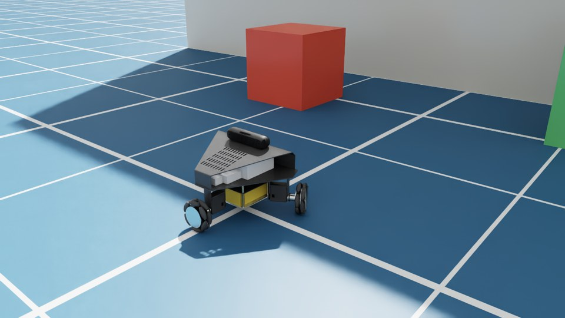
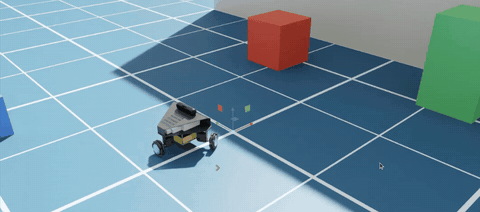
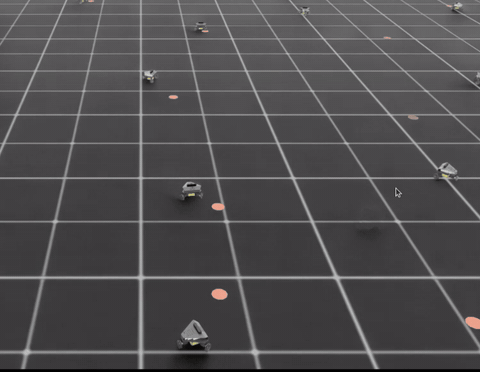
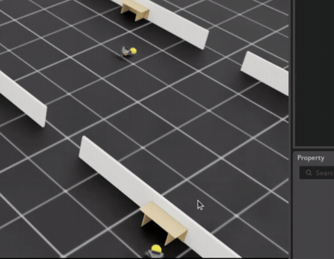
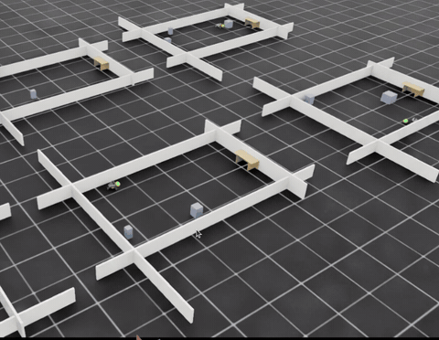
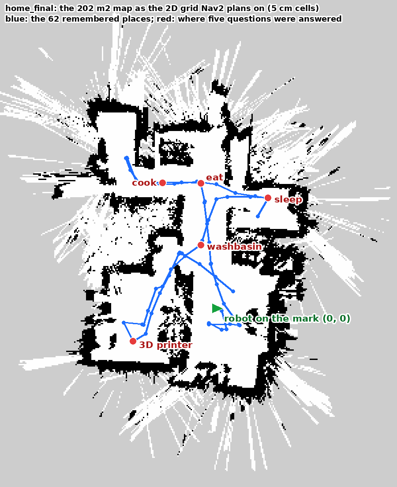

# Kaya

A three-wheel omnidirectional robot on a Jetson Orin Nano 8 GB that **maps a
home in 3D, finds itself in that map after a restart, drives to a goal,
answers "take me where I can cook"**, and, in a second project, **learned to
play football in simulation and scored with the real ball**.

Everything here was measured on one robot. The numbers below are the ones
that were verified on hardware, not targets.

| capability | measured |
|---|---|
| visual-inertial odometry (cuVSLAM on the stereo IR pair) | 0.63% drift over 16.9 m |
| map of a real flat (nvblox) | 202 m², 468k vertices |
| relocalisation after a restart | 5.9 cm from a pose hint 5 m wrong |
| autonomous navigation (Nav2, omni) | 3.5 m traverses to 6-14 cm; 0.5 m pure strafe with 0.1° heading change |
| "where can I eat / cook / sleep / wash" | six acceptance questions, six different correct places; drove 5.1 m to the kitchen to 14 cm |
| RL in Isaac Lab: drive to a point | 100% success in 3 minutes of training |
| RL: find, dribble and score a ball | sim 99.9%; **real robot 3 goals in 4**, from beside the box, from behind, and out of a corner |

## See it

| | |
|---|---|
|  |  |
| **The calibrated twin in Isaac Sim 6.0.** Chassis, three wheels, 36 free rollers, servo drives and the Gemini 335L, every number measured on the real robot (`kaya_description/usd/`). | **Driving it** with W/A/S/D/Q/E through the same servo model the training uses. |
|  |  |
| **Isaac Lab, task 1:** drive to the orange point and stop. Thousands of robots train at once; 100% success after three minutes. | **Task 2, the learned policy:** find the yellow ball, get behind it, dribble it into the box. The policy never sees an image; it sees what a detector would report. |
|  |  |
| **v2, "play like a footballer":** rooms with walls, corners and obstacles, because a ball in a corner was unrecoverable on the real floor. | **The real robot, run 24:** out from behind the side panel, round the front, and in. v2.4 scored 3 of 4 from the hardest starts. |

**The flat as the robot knows it.** The 202 m² grid nvblox built, the 62 places the
robot remembered as it drove (blue), and where "where can I eat / cook / wash /
sleep / find the 3D printer" were answered (red). The white rays outside the walls
are what the depth camera saw through windows and doorways.

## Hardware

| part | this build |
|---|---|
| compute | Jetson Orin Nano **8 GB** (JetPack 7.2.1, flashed with the `-super` config) |
| camera | Orbbec Gemini 335L: stereo IR, depth, colour, and the IMU the robot uses |
| drive | 3 × Waveshare ST3020 serial-bus servos, 74 mm omni wheels at 60 / 180 / 300° |
| power | 20 V 2.0 Ah power-tool pack; ~2.5 h with the full stack |
| workstation | Ubuntu 24.04, ROS 2 Jazzy, RTX 5090 24 GB (dashboard, perception, Isaac Sim / Isaac Lab) |

Measurements, and how each was taken: `kaya_description/cad/`.

## Start here

| you want to | read |
|---|---|
| **build and run a Kaya** from a flashed Jetson to navigation, the dashboard and the question box | [`GETTING_STARTED.md`](GETTING_STARTED.md) |
| **train it in Isaac Lab** and run the ball policy on the robot | [`kaya_lab/README.md`](kaya_lab/README.md) |
| **learn what was learned**: every concept, fault, measurement and fix, in teaching order | [`LEARNINGS.md`](LEARNINGS.md) |
| know why a setting is what it is, and what is still open | [`ROADMAP.md`](ROADMAP.md) |
| the RL plan with every result recorded | [`SIM_RL_PLAN.md`](SIM_RL_PLAN.md) |

## What is in the repo

| folder | what |
|---|---|
| `robot_setup/` | provisioning a fresh JetPack 7 flash (ROS 2 Jazzy, Isaac ROS 4.6, wifi driver, camera patch), health check, the full setup log |
| `kaya_drive/` | the holonomic drive: servo bus, kinematics, `/cmd_vel` in, `/odom` and `/joint_states` out; servo tools |
| `kaya_imu/` | conditions the camera's IMU (bias, covariances, re-zero while still) |
| `kaya_description/` | URDF, the measured dimensions (`cad/`), and the calibrated **Isaac Sim robot** (`usd/`) |
| `kaya_bringup/` | the launch files (cuVSLAM, nvblox, Nav2), the guard nodes, Nav2 configs, and the diagnostic tools that each answered a question that cost a day |
| `dashboard/` | web dashboard on the workstation: live map, robot, planner, camera, click-to-navigate, teleop, the Ask box |
| `perception/` | workstation perception: keyframe store, scene memory (caption once, query many), open-vocabulary detection and following |
| `kaya_lab/` | Isaac Lab extension: tasks, servo model, detectors, the robot-side policy node, the best policy, all 38 real-run logs |

## Honest status

- The navigation and ball-demo paths both work on this robot, and every
  script a second builder needs is now in the repo. The guide has **not yet
  been followed end to end on a second Kaya**; it says so where it matters.
- Relocalisation into the saved map stopped working once the furniture moved;
  navigation runs from a marked start instead. The cause of the shrinking
  recovery radius is **unresolved** (`ROADMAP.md`).
- The camera's IR frames arrive ~0.47 s late whenever depth is enabled. That
  is the on-device depth engine, not software; the stack is configured for
  the latency that exists.
- Ball policy v2.5 (panels count as bumps) is written and smoke-tested, not
  trained. v2.4 is the deployed one.

## Licence

Apache-2.0 (`LICENSE`). `kaya_drive/kaya_drive/scservo_sdk/` is Feetech's SDK,
public domain (its own `LICENSE`). `kaya_description/usd/sensors/` vendors
NVIDIA's Gemini 335L asset so the simulator loads offline.
